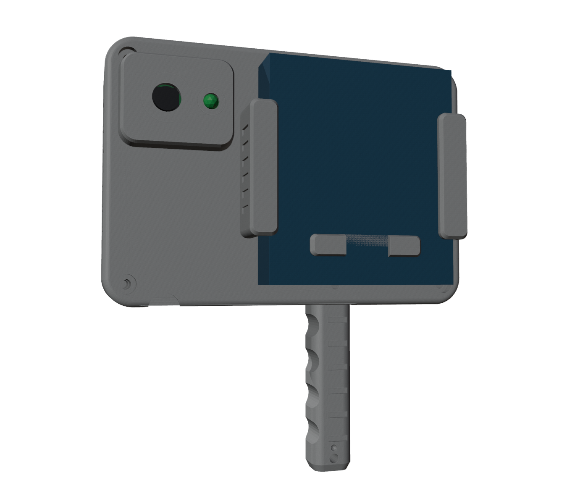
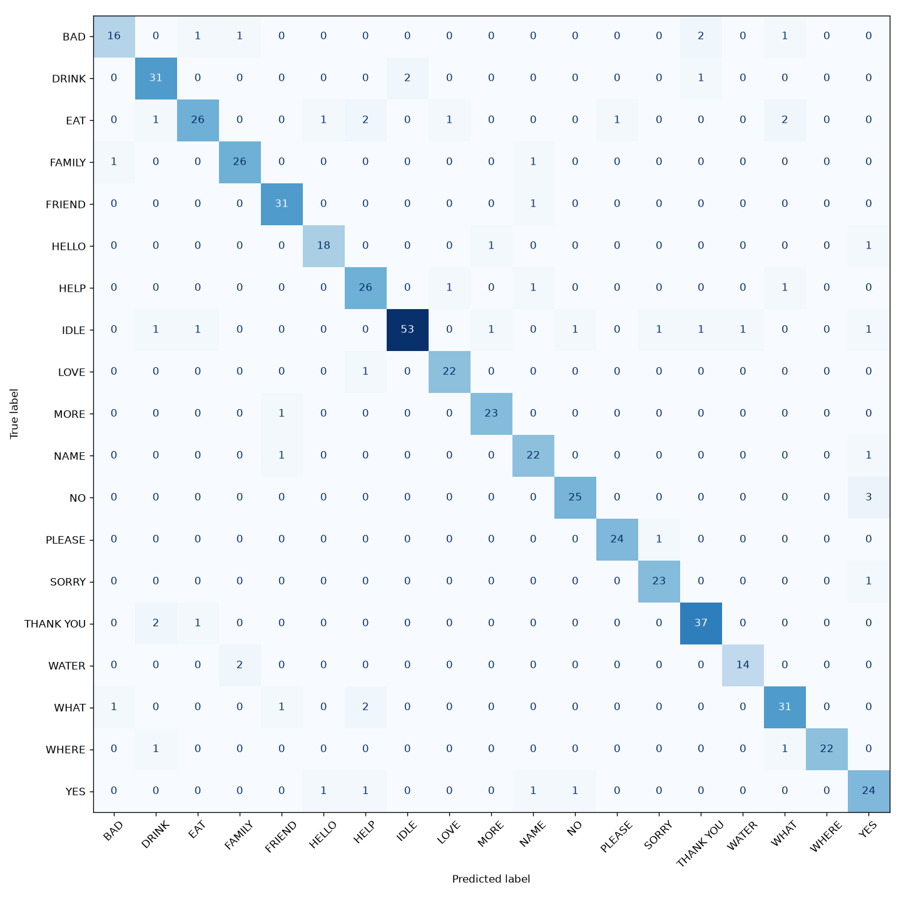

# ASL Assistant (Senior Capstone Project)

An intelligent, real-time American Sign Language (ASL) recognition system supporting webcam video input, real-time MediaPipe hand landmark extraction, machine learning classification, and text-to-speech synthesis.

Built with four distinct operational modes for learning, typing, word recognition, and continuous sentence conversation, along with a custom 3D-printable handheld communicator enclosure.

---

## ASL Portable Communicator — V9 Precision CAD Specification
*(Universal Power Bank Mechanism, Status LEDs & Pure-Pivot Bottom-Base Handle)*

### 1. Studio Visual Tour (4 Key Views & Handle Kinematics)

#### Front Screen Face & Rear Camera Face
<p align="center">
  
  
</p>
<p align="center">
  <em>Left: <b>Front Screen Face</b> (3× Status LEDs above 2.8" TFT Screen, Dual Stacked Ø40mm Speakers, and Deployed Perpendicular Base Handle).<br />
  Right: <b>Rear Camera Face</b> (Universal Multi-Size Power Bank Cradle, Sliding Clamp, and Green Optical Visor Tally LED).</em>
</p>

#### Pure-Pivot Bottom-Base Handle Kinematics
<p align="center">
  
  
</p>
<p align="center">
  <em>Left: <b>Handle Mid-Fold (-45°)</b> rotating smoothly on its fixed Y-axis M3 hinge pin.<br />
  Right: <b>Handle 100% Flush Stowed (-90°)</b> resting completely flush inside the bottom base recess (Z = -43.0 mm).</em>
</p>

> [!NOTE]
> The bottom element is a dedicated **Pure-Pivot Folding Handle** (not a multi-angle kickstand). It rotates on a fixed Y-axis hinge pin from **0° (deployed perpendicular to base for secure handheld signing)** to **-90° (fully flush inside the bottom recess for pocket transport)**.

---

### 2. Engineering Verification (124.0 mm × 86.0 mm × 35.4 mm Main Body)

* **Real-World Power Bank Survey & Universal Multi-Size Clamp Mechanism**: Engineered to accept virtually any standard 5,000mAh – 10,000mAh power bank (50–76 mm wide, 80–150+ mm long, and 9–26 mm thick) via a Fixed Left C-Clamp Jaw, a Bottom L-Support Ledge with USB Cable Pass-Through, a Sliding & Ratcheting Right Clamp Jaw (`ASL_PowerBank_Clamp`) with a 26 mm M3 locking slot + 2.0 mm-pitch anti-slip ratchet teeth, and Dual 15 mm Velcro/Elastic Strap Tunnels — all while keeping the upper-right camera & LED visor (X = +39.5 mm, Z = +22.0 mm) 100% unobstructed.
* **Status Indicator LEDs (4× 5mm Standard T-1¾ LEDs)**:
  * **Screen Face (`ASL_Front_Shell`, -Y)**: 3× 5mm LEDs (Red, Yellow, Green) centered horizontally above the 2.8" TFT touchscreen at Z = +31.5 mm (X = -31.5 mm Red, X = -19.5 mm Yellow, X = -7.5 mm Green) with recessed conical bezels (Ø7.6 mm) and internal Ø5.2 mm push-fit retaining sleeves.
  * **Camera Face (`ASL_Rear_Shell`, +Y)**: 1× 5mm Green LED integrated directly into the raised Optical Camera Visor Island beside the OV5647 lens at (X = +29.5 mm, Y = +21.0 mm, Z = +22.0 mm) so the signer knows when recognition is active.
* **Physically Valid Pure-Pivot Bottom-Base Folding Handle (`ASL_Ergonomic_Handle`)**: Mounted directly in the bottom base wall (Z = -43.0 mm, Y = +7.8 mm) on a fixed Y-axis M3 hinge pin (X_p = -14.0 mm, Y_p = +7.8 mm, Z_p = -36.0 mm) with a rounded R = 7.0 mm pivot head so it rotates purely from 0° (Perpendicular to Base) through -45° (Mid-Fold) to -90° (100% Flush Stowed at Z = -43.0 mm) with zero collision and zero translation.

---

### 3. Real-World Power Bank Survey & Universal Clamp Engineering

#### 3.1 Market Dimension Survey (5,000mAh – 10,000mAh Power Banks)

| Power Bank Model | Capacity | Length (Z) | Width (X) | Thickness (Y) | Fits V9 Universal Cradle? |
| :--- | :---: | :---: | :---: | :---: | :--- |
| **Anker Nano 30W (A1259)** | 10,000 mAh | 104.0 mm | 52.3 mm | 26.0 mm | **Yes** (Sliding Clamp + Strap) |
| **Anker PowerCore (A1257)** | 10,000 mAh | 113.8 mm | 70.6 mm | 16.5 mm | **Yes** (Sliding Clamp Jaws) |
| **Anker Zolo / A1388** | 10,000 mAh | 151.0 mm | 71.4 mm | 15.9 mm | **Yes** (Open-Top Vertical Channel) |
| **Anker MagGo (5K)** | 5,000 mAh | 96.0 mm | 69.0 mm | 15.0 mm | **Yes** (Sliding Clamp Jaws) |
| **Xiaomi Ultra Compact** | 10,000 mAh | 90.0 mm | 63.9 mm | 24.4 mm | **Yes** (Sliding Clamp + Strap) |
| **Xiaomi 22.5W (PB100DPDZM)** | 10,000 mAh | 147.8 mm | 73.9 mm | 15.3 mm | **Yes** (Max Clamp Width 76 mm) |
| **INIU Carry (P50-E1)** | 10,000 mAh | 83.0 mm | 52.0 mm | 26.0 mm | **Yes** (Min Clamp Width 50 mm) |
| **INIU Pocket (P41)** | 10,000 mAh | 110.0 mm | 67.0 mm | 18.0 mm | **Yes** (Sliding Clamp Jaws) |
| **INIU Ultra-Slim (P75)** | 5,000 mAh | 99.0 mm | 67.0 mm | 9.0 mm | **Yes** (Foam Pad / Strap Tension) |

#### 3.2 4-Stage Universal Power Bank Retention System
1. **Left Fixed C-Clamp Jaw (X = -58.0 mm inner stop)**: Built into the left side of `ASL_Rear_Shell` with a 4.0 mm wrap-around retention lip (Y = +35.0 to +38.0 mm) that holds the left edge of any power bank (up to 16.5 mm under the hard lip, or up to 26 mm with the strap).
2. **Sliding & Ratcheting Right Clamp Jaw (`ASL_PowerBank_Clamp`)**:
   * Slides horizontally along a precision dovetail guide slot (Z = -9.0 to +9.0 mm) with 26.0 mm of lateral travel, adjusting the clamping width continuously from 50.0 mm to 76.0 mm.
   * Features 14 interlocking ratchet teeth (2.0 mm pitch) on the rear wall and clamp base, locked firmly in place by a single M3 thumbscrew / bolt passing through the 26.0 mm slotted rail (Z = 0.0 mm, X = -12.0 to +14.0 mm).
3. **Bottom Load-Bearing L-Support Ledge (Z = -26.0 mm) with Cable Cutout**: Supports the weight of the power bank from underneath while providing an open central pass-through (X = -32.0 to -12.0 mm) so bottom-mounted USB-C / USB-A charging cables can plug in cleanly without interference.
4. **Open-Top Vertical Channel & Dual 15 mm Velcro Strap Tunnels**:
   * Because the top of the left-side cradle (X < +18.0 mm) is open, long power banks (110–151 mm) simply extend upward cleanly on the left side while leaving the right-side Camera & Green LED Optical Visor (X = +39.5 mm, Z = +22.0 mm) completely unobstructed.
   * Two 15.0 mm-wide sub-surface strap tunnels (Z = -12.0 mm and Z = +12.0 mm) pass underneath the power bank bed (Y = +15.8 to +18.5 mm), allowing a standard 15 mm Velcro cinch strap to lock ultra-thin (9 mm) or ultra-thick (26 mm) power banks with zero rattle.

---

### 4. Status LEDs Specification (Screen Face & Camera Face)

| LED Designator | Face / Shell | Color | Coordinates (X, Y, Z) | Mounting Geometry | Functional Role |
| :--- | :---: | :---: | :---: | :--- | :--- |
| **`LED_Front_Red`** | Screen Face (`ASL_Front_Shell`) | **Red** | (-31.5, -17.4, +31.5 mm) | Ø5.2 mm through-bore + Ø7.6 mm conical bezel + internal Ø8.8 mm retaining boss | Error / Low Battery / Standby Alert |
| **`LED_Front_Yellow`** | Screen Face (`ASL_Front_Shell`) | **Yellow** | (-19.5, -17.4, +31.5 mm) | Ø5.2 mm through-bore + Ø7.6 mm conical bezel + internal Ø8.8 mm retaining boss | Processing / Translating Gesture |
| **`LED_Front_Green`** | Screen Face (`ASL_Front_Shell`) | **Green** | (-7.5, -17.4, +31.5 mm) | Ø5.2 mm through-bore + Ø7.6 mm conical bezel + internal Ø8.8 mm retaining boss | System Ready / Speech Output Active |
| **`LED_Rear_Green`** | Camera Face (`ASL_Rear_Shell`) | **Green** | (+29.5, +21.0, +22.0 mm) | Integrated inside raised Optical Camera Visor (Ø5.2 mm bore + Ø7.8 mm glare-shield bezel) | Signer Tally Light (Camera Active / Tracking Hand) |

---

### 5. Pure-Pivot Bottom-Base Handle Kinematics

* **Fixed Hinge Axis (Y-Axis M3 Pin at $X_p = -14.0\text{ mm}$, $Y_p = +7.8\text{ mm}$, $Z_p = -36.0\text{ mm}$)**:
  * Handle cross-section is $14.0\text{ mm}\ (X) \times 13.0\text{ mm}\ (Y)$ with a semicircular $R = 7.0\text{ mm}$ top hinge head centered on the pin.
  * Because the pin is located exactly $7.0\text{ mm}$ above the bottom base ($Z_p = -36.0\text{ mm}$, bottom base $Z = -43.0\text{ mm}$), rotating the handle $-90^\circ$ around $Y$ maps its $14.0\text{ mm}$ width ($X \in [-21.0, -7.0\text{ mm}]$) directly into the vertical pocket height ($Z \in [-43.0, -29.0\text{ mm}]$).
  * Its bottom face lands at $Z = -43.0\text{ mm}$ ($0.0\text{ mm}$ flush with the bottom of the enclosure!) and its $70.0\text{ mm}$ total length lies cleanly inside the $X \in [-21.4, +50.0\text{ mm}]$ bottom-base recess with zero collision and zero translation.

---

### 6. Watertight 3D-Printable STL Files (0 Non-Manifold Edges Verified)

All 4 printable parts are saved in the master Blender scene ([`cad/asl_communicator_model.blend`](cad/asl_communicator_model.blend)) and exported as slicer-ready `.stl` files:

| Part Name | STL File Link | Dimensions ($X \times Y \times Z$) | Mesh Integrity |
| :--- | :--- | :---: | :--- |
| **`ASL_Front_Shell`** | [`cad/asl_front_shell.stl`](cad/asl_front_shell.stl) | $124.00 \times 17.10 \times 86.00\text{ mm}$ | **0 non-manifold edges**, 0 boundary edges |
| **`ASL_Rear_Shell`** | [`cad/asl_rear_shell.stl`](cad/asl_rear_shell.stl) | $124.00 \times 34.25 \times 86.00\text{ mm}$ | **0 non-manifold edges**, 0 boundary edges |
| **`ASL_Ergonomic_Handle`** | [`cad/asl_ergonomic_handle.stl`](cad/asl_ergonomic_handle.stl) | $14.00 \times 13.00 \times 70.00\text{ mm}$ | **0 non-manifold edges**, 0 boundary edges |
| **`ASL_PowerBank_Clamp`** | [`cad/asl_powerbank_clamp.stl`](cad/asl_powerbank_clamp.stl) | $22.00 \times 18.40 \times 42.00\text{ mm}$ | **0 non-manifold edges**, 0 boundary edges |

---

## Key Capabilities & Operational Modes

Switch modes instantly using numeric keys **`1`**, **`2`**, **`3`**, **`4`**, or cycle sequentially using **`m`** / **`TAB`**:

| Key | Mode | Operational Purpose & Behavior |
| :---: | :--- | :--- |
| **`1`** | **`alphabets`** | **Live Letter Inspection & Practice**: Instant visual feedback for single static letters (A–Z) and motion gestures (J and Z). Landmarks and top predictions are rendered in real time. **Typing is paused** so learners can inspect handshapes without altering the sentence buffer. |
| **`2`** | **`spelling`** | **Fingerspelling Typing Engine**: Types letters into an accumulated sentence bar. Requires a sign to be held for 0.6 s with $\ge 80\%$ agreement. Dynamic motion gestures (J/Z) replace initial lookalike letters (e.g., replaces an initial 'I' when 'J' completes). Spoken aloud via TTS. |
| **`3`** | **`words`** | **Whole-Word ASL Recognition**: Dynamic whole-word gesture recognition powered by a high-precision Soft-Voting Ensemble (**89.8% held-out test accuracy**). Tracks 2-hand signing trajectories; classifies and pronounces isolated ASL signs when hands drop or pause. |
| **`4`** | **`sentences`** | **Continuous Sentence Mode**: Chains successive signs together into fluid English sentences. Automatically cleans up duplicate transitions, smooths ASL glosses into natural grammar, and speaks the complete sentence hands-free after a 1.8 s rest pause or upon pressing `ENTER`. |

---

## Keyboard Controls & Shortcuts

| Key | Action |
| :---: | :--- |
| **`1`** | Switch to **Mode 1: Alphabets** (Live Inspection) |
| **`2`** | Switch to **Mode 2: Spelling** (Fingerspelling Typing) |
| **`3`** | Switch to **Mode 3: Words** (Whole-Word ASL) |
| **`4`** | Switch to **Mode 4: Sentences** (Continuous ASL) |
| **`m` / `TAB`** | Cycle to the next mode sequentially (`1` $\to$ `2` $\to$ `3` $\to$ `4` $\to$ `1`) |
| **`SPACE`** | Insert a space into the sentence buffer |
| **`BACKSPACE`** | Delete the last character (Spelling mode) or remove the last signed word (Sentences mode) |
| **`ENTER`** | Speak the entire accumulated sentence aloud immediately |
| **`c`** | Clear the sentence buffer |
| **`d`** | Toggle diagnostic overlay (FPS, latency breakdown, movement distance) |
| **`f`** | Toggle fullscreen display |
| **`q`** | Quit application |

---

## Setup & Running

### Prerequisites
* Windows 10/11 or Linux
* Python 3.12 64-bit

### 1. Fast Setup with Virtual Environment
```powershell
# Clone the repository
git clone https://github.com/3bbaset/asl-assistant.git
cd asl-assistant

# Create virtual environment and install dependencies
py -3.12 -m venv .venv
.\.venv\Scripts\activate
pip install -r requirements.txt
```

### 2. Launching the Application
You can run the application directly using the included `run.bat` helper script or Python:

```cmd
# Start directly (default: Spelling mode)
run

# Or launch directly into any specific mode:
run --mode alphabets
run --mode spelling
run --mode words
run --mode sentences

# High-performance mode (shared detector, recommended for laptops / single-camera devices):
run --share
```

---

## Hardware Prototype Mode (Client / Server Split)

For deployment on embedded hardware (e.g. Raspberry Pi + laptop backend):

1. **Host / Server (Laptop/PC)** — runs all inference and ML models:
   ```cmd
   python server.py
   ```
2. **Device / Client (Raspberry Pi or secondary machine)** — handles camera capture, UI display, and audio output:
   ```cmd
   python device.py --server http://<LAPTOP_IP>:8000
   ```

---

## Word Recognition Model & Performance

The dynamic word model classifies 30-frame interpolated trajectory clips (1,935 geometric features per clip covering inter-finger angles, joint distances, wrist velocities, and 2-hand relative distances).

* **Evaluated on 80/20 held-out split**:
  * **Test Accuracy**: **89.8%**
  * **Precision**: **90.0%**
  * **Architecture**: Soft-Voting Ensemble (Regularized Logistic Regression + ExtraTrees)
* **Model File**: `word_model.joblib` (compressed to 6.4 MB for rapid loading and deployment)
* **Training Data**: `word_clips.npz` (8.5 MB compressed landmark dataset)

<p align="center">
  
  
</p>

To retrain the word model from `word_clips.npz`:
```cmd
python train_words.py
```

To practice words interactively split-screen with reference videos:
```cmd
python quiz_words.py
```

---

## File Structure

| Directory / File | Description |
| :--- | :--- |
| `app.py` | Full desktop application with all 4 operational modes, webcam pipeline, and speech. |
| `run.bat` | One-click Windows runner that automatically uses the project virtual environment. |
| `brain.py` | Headless inference engine containing all classification, state machine, and mode logic. |
| `server.py` | Lightweight HTTP server hosting `Brain` for hardware/Pi clients. |
| `device.py` | Lightweight client interface for embedded devices (camera capture + display). |
| `cad/` | 3D printable CAD models (STLs), renders, and Blender scene for the hardware enclosure. |
| `words_common.py` | Word feature extraction, geometric calculations, and grammar sentence smoothing. |
| `words_live.py` | Real-time 2-hand word segmenter, classifier interface, and drawing helpers. |
| `train_words.py` | Training script for the 89.8% accuracy ensemble word model. |
| `quiz_words.py` | Interactive split-screen training and reference comparison tool. |
| `asl_model_v2.joblib` | Trained static letter model (A–Z). |
| `motion_model2.joblib` | Trained dynamic motion model (J, Z, IDLE). |
| `word_model.joblib` | Trained conversational word recognition ensemble model. |
| `hand_landmarker.task` | Google MediaPipe 2-hand tracking landmark model. |
