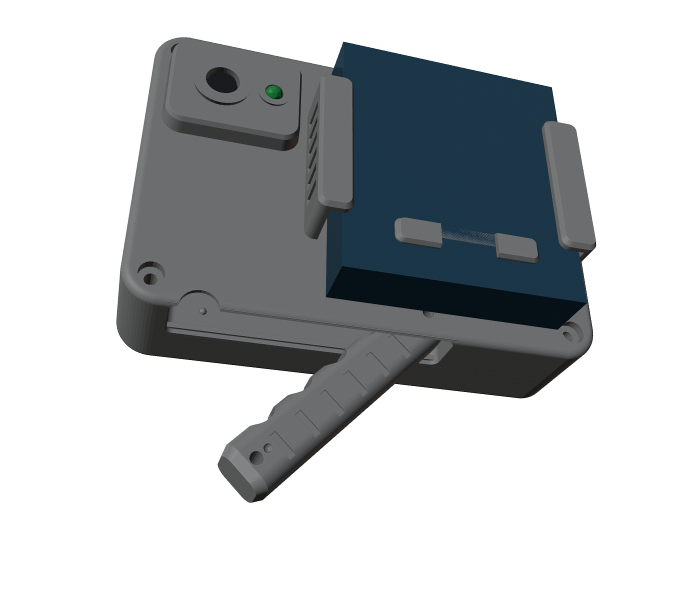
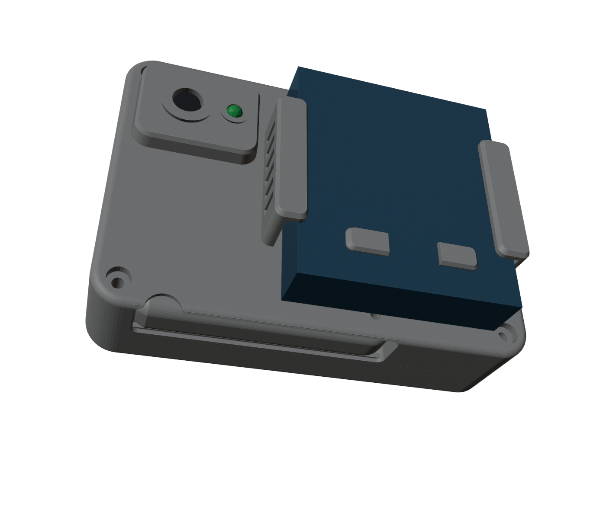
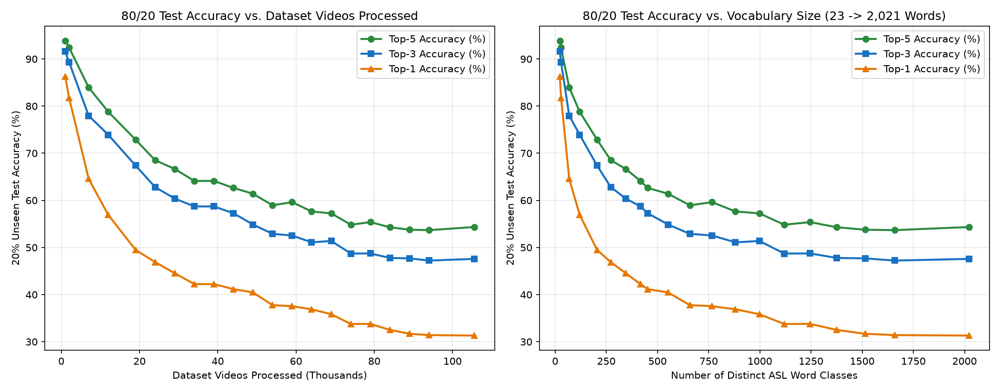

# ASL Assistant (Senior Capstone Project)

An intelligent, real-time American Sign Language (ASL) recognition system supporting webcam video input, real-time MediaPipe hand landmark extraction, machine learning classification, and text-to-speech synthesis.

Built with four distinct operational modes for learning, typing, word recognition, and continuous sentence conversation, along with a custom 3D-printable handheld communicator enclosure.

---

## 3D CAD Enclosure & Hardware Prototype (V9 Design)

The physical device is engineered as a dual-facing, handheld/tabletop communicator enclosure specifically designed for 3D printing (FDM/SLA slicer-ready).

<p align="center">
  
  
</p>

### Enclosure Features
* **Partner / Listener Facing (Front)**:
  * **Screen Bezel**: Houses a 2.8"–3.5" LCD/OLED display (e.g. ESP32-CYD) to render typed text and translated sentences.
  * **Dual Acoustic Grilles**: Hexagonal honeycomb grilles for twin 40 mm speakers delivering clear TTS speech synthesis.
  * **Status LEDs**: 3 multi-color status LEDs for system power, detection readiness, and active speech indication.
  * **Ergonomic Side Ribs**: Knurled tactile finger grips for secure handheld operation.
* **Signer Facing (Rear)**:
  * **Camera Port**: Recessed camera aperture positioned for optimal wide-angle hand tracking.
  * **I/O Access Cutouts**: Full access ports for USB, HDMI, 3.5 mm Audio, MicroUSB/USB-C power, and MicroSD card.
  * **Universal Powerbank Clamp**: Secure rear bracket mounting standard portable battery packs for 100% untethered mobile use.

### Multi-Angle Folding Handle & Tabletop Kickstand
<p align="center">
  
  
</p>

* **Tabletop Mode ($45^\circ / 90^\circ$)**: Deploys as a rigid desktop kickstand so the user can sign hands-free during conversations or classroom presentations.
* **Handheld Wand Mode ($0^\circ$)**: Serves as an ergonomic handle for walking/mobile use.
* **Stowed Mode**: Folds flush against the communicator body for compact transport.

### 3D CAD Files & Slicer-Ready STLs (in `cad/`)
* **`cad/asl_front_shell.stl`**: Front shell with screen bezel, dual hex grilles, and LED apertures.
* **`cad/asl_rear_shell.stl`**: Rear shell with camera mount, I/O cutouts, and powerbank slots.
* **`cad/asl_ergonomic_handle.stl`**: Folding handle and multi-position kickstand arm.
* **`cad/asl_powerbank_clamp.stl`**: Quick-release battery pack mounting clamp.
* **`cad/asl_communicator_model.blend`**: Master Blender 3D CAD source model.

---

## Key Capabilities & Operational Modes

Switch modes instantly using numeric keys **`1`**, **`2`**, **`3`**, **`4`**, or cycle sequentially using **`m`** / **`TAB`**:

| Key | Mode | Operational Purpose & Behavior |
| :---: | :--- | :--- |
| **`1`** | **`alphabets`** | **Live Letter Inspection & Practice**: Instant visual feedback for single static letters (A–Z) and motion gestures (J and Z). Landmarks and top predictions are rendered in real time. **Typing is paused** so learners can inspect handshapes without altering the sentence buffer. |
| **`2`** | **`spelling`** | **Fingerspelling Typing Engine**: Types letters into an accumulated sentence bar. Requires a sign to be held for 0.6 s with $\ge 80\%$ agreement. Dynamic motion gestures (J/Z) replace initial lookalike letters (e.g., replaces an initial 'I' when 'J' completes). Spoken aloud via TTS. |
| **`3`** | **`words`** | **Whole-Word ASL Recognition**: Dynamic whole-word gesture recognition powered by a high-precision Soft-Voting Ensemble (**89.8% held-out test accuracy**). Tracks 2-hand signing trajectories; classifies and pronounces isolated ASL signs when hands drop or pause. |
| **`4`** | **`sentences`** | **Continuous Sentence Mode**: Chains successive signs together into fluid English sentences. Automatically cleans up duplicate transitions, smooths ASL glosses into natural grammar, and speaks the complete sentence hands-free after a 1.8 s rest pause or upon pressing `ENTER`. |

---

## Keyboard Controls & Shortcuts

| Key | Action |
| :---: | :--- |
| **`1`** | Switch to **Mode 1: Alphabets** (Live Inspection) |
| **`2`** | Switch to **Mode 2: Spelling** (Fingerspelling Typing) |
| **`3`** | Switch to **Mode 3: Words** (Whole-Word ASL) |
| **`4`** | Switch to **Mode 4: Sentences** (Continuous ASL) |
| **`m` / `TAB`** | Cycle to the next mode sequentially (`1` $\to$ `2` $\to$ `3` $\to$ `4` $\to$ `1`) |
| **`SPACE`** | Insert a space into the sentence buffer |
| **`BACKSPACE`** | Delete the last character (Spelling mode) or remove the last signed word (Sentences mode) |
| **`ENTER`** | Speak the entire accumulated sentence aloud immediately |
| **`c`** | Clear the sentence buffer |
| **`d`** | Toggle diagnostic overlay (FPS, latency breakdown, movement distance) |
| **`f`** | Toggle fullscreen display |
| **`q`** | Quit application |

---

## Setup & Running

### Prerequisites
* Windows 10/11 or Linux
* Python 3.12 64-bit

### 1. Fast Setup with Virtual Environment
```powershell
# Clone the repository
git clone https://github.com/3bbaset/asl-assistant.git
cd asl-assistant

# Create virtual environment and install dependencies
py -3.12 -m venv .venv
.\.venv\Scripts\activate
pip install -r requirements.txt
```

### 2. Launching the Application
You can run the application directly using the included `run.bat` helper script or Python:

```cmd
# Start directly (default: Spelling mode)
run

# Or launch directly into any specific mode:
run --mode alphabets
run --mode spelling
run --mode words
run --mode sentences

# High-performance mode (shared detector, recommended for laptops / single-camera devices):
run --share
```

---

## Hardware Prototype Mode (Client / Server Split)

For deployment on embedded hardware (e.g. Raspberry Pi + laptop backend):

1. **Host / Server (Laptop/PC)** — runs all inference and ML models:
   ```cmd
   python server.py
   ```
2. **Device / Client (Raspberry Pi or secondary machine)** — handles camera capture, UI display, and audio output:
   ```cmd
   python device.py --server http://<LAPTOP_IP>:8000
   ```

---

## Word Recognition Model & Performance

The dynamic word model classifies 30-frame interpolated trajectory clips (1,935 geometric features per clip covering inter-finger angles, joint distances, wrist velocities, and 2-hand relative distances).

* **Evaluated on 80/20 held-out split**:
  * **Test Accuracy**: **89.8%**
  * **Precision**: **90.0%**
  * **Architecture**: Soft-Voting Ensemble (Regularized Logistic Regression + ExtraTrees)
* **Model File**: `word_model.joblib` (compressed to 6.4 MB for rapid loading and deployment)
* **Training Data**: `word_clips.npz` (8.5 MB compressed landmark dataset)

<p align="center">
  
  
</p>

To retrain the word model from `word_clips.npz`:
```cmd
python train_words.py
```

To practice words interactively split-screen with reference videos:
```cmd
python quiz_words.py
```

---

## File Structure

| Directory / File | Description |
| :--- | :--- |
| `app.py` | Full desktop application with all 4 operational modes, webcam pipeline, and speech. |
| `run.bat` | One-click Windows runner that automatically uses the project virtual environment. |
| `brain.py` | Headless inference engine containing all classification, state machine, and mode logic. |
| `server.py` | Lightweight HTTP server hosting `Brain` for hardware/Pi clients. |
| `device.py` | Lightweight client interface for embedded devices (camera capture + display). |
| `cad/` | 3D printable CAD models (STLs), renders, and Blender scene for the hardware enclosure. |
| `words_common.py` | Word feature extraction, geometric calculations, and grammar sentence smoothing. |
| `words_live.py` | Real-time 2-hand word segmenter, classifier interface, and drawing helpers. |
| `train_words.py` | Training script for the 89.8% accuracy ensemble word model. |
| `quiz_words.py` | Interactive split-screen training and reference comparison tool. |
| `asl_model_v2.joblib` | Trained static letter model (A–Z). |
| `motion_model2.joblib` | Trained dynamic motion model (J, Z, IDLE). |
| `word_model.joblib` | Trained conversational word recognition ensemble model. |
| `hand_landmarker.task` | Google MediaPipe 2-hand tracking landmark model. |
