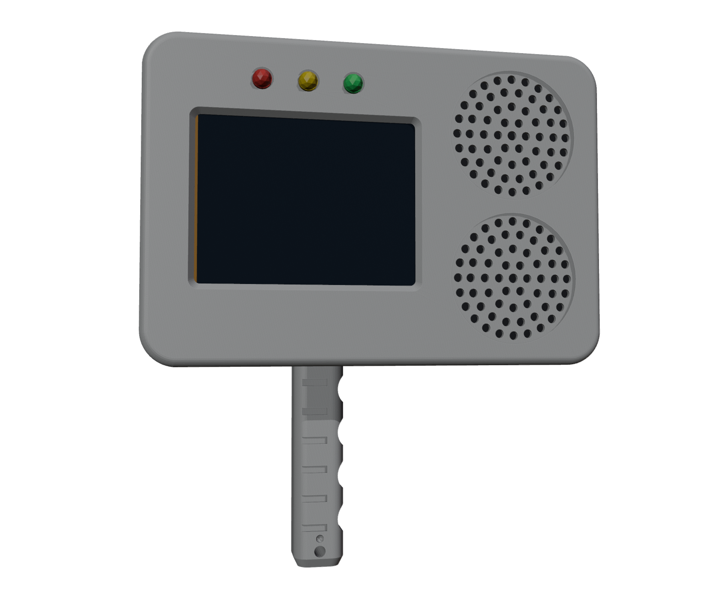

# Bilingual ASL & ArSL Sign Language Assistant

A real-time **American Sign Language (ASL)** and **Arabic / Egyptian Sign Language (ArSL)** translation system powered by Google MediaPipe 2-hand landmarks, scikit-learn / LightGBM / Neural classifiers, bilingual EN↔AR text translation, English/Arabic text-to-speech, and an interactive localhost **Capstone Prototype Dashboard**. Designed to run standalone on a laptop or as a portable **Raspberry Pi + ESP32 Touchscreen** communicator.

---

## System Architecture

```text
+-----------------------+   UART (115200)   +------------------------+   TCP :9000 (Wi-Fi)   +-----------------------+
| ESP32-2432S028R (CYD) | <---------------> |     Raspberry Pi       | <-------------------> |   Laptop AI Engine    |
| 2.8" TFT + Arabic Font|  Mode/Lang CMDs   | rpicam-vid + espeak-ng |  JPEG frames / JSON   | MediaPipe + 6 Models  |
| 5 Tabs + IN/OUT Toggle|  ASCII + ar_hex   | pi_device.py (systemd) |  Text, AR Hex, Speech | ai_engine.py + :8080  |
+-----------------------+                   +------------------------+                       +-----------------------+
                                                                                                       │
                                                                                              HTTP SSE + MJPEG
                                                                                                       ▼
                                                                                         [Capstone Web Dashboard]
                                                                                          http://127.0.0.1:8080
```

* **ESP32 Display (`esp32_firmware.py` + `ar_font.bin`)**: 320×240 touch interface with 5 mode tabs (`ALPHA`, `SPELL`, `W:30`, `W:2K`, `SENT`), **`IN:ASL` / `IN:AR`** and **`OUT:EN` / `OUT:AR`** toggles, `SPACE`/`DEL`/`CLEAR`/`SPEAK` buttons, and a 16×16 RTL Arabic bitmap renderer.
* **Raspberry Pi (`pi_device.py`)**: Streams camera frames over TCP `:9000`, bridges UART commands to/from the ESP32, and speaks English (`en-us`) or Arabic (`ar`) via `espeak-ng`.
* **Laptop AI Engine (`ai_engine.py` + `brain.py`)**: Runs MediaPipe + ASL/ArSL models, offline-first EN↔AR translation (`translator.py`), `--gui` OpenCV debug window with dual-hand skeletons, and embeds the localhost Capstone Dashboard on port `8080`.

---

## Capstone Benchmark Results (`reports/capstone_metrics.json`)

| Model | Track | Algorithm | Classes | Train / Test | Top-1 Acc | Top-3 Acc | Macro-F1 | Infer (ms) |
| :--- | :---: | :--- | :---: | :---: | :---: | :---: | :---: | :---: |
| **ASL Static Alphabet** | ASL | `HistGradientBoostingClassifier` | 24 | 46,964 / 12,068 | **98.10%** | 99.30% | 97.88% | 0.061 |
| **ASL Motion Letters (J, Z, IDLE)** | ASL | `SVC` (5-fold GroupKFold OOF) | 3 | 104 / 130 | **97.69%** | — | 97.74% | 0.572 |
| **ASL Conversational Words** | ASL | Soft-Voting Ensemble | 32 | 762 / 191 | **77.94%** | 90.20% | 76.00% | 0.470 |
| **ASL Full Vocabulary** | ASL | `MLPClassifier` | 2,021 | 38,116 / 9,529 | **31.31%** | 47.58% | 29.64% | — |
| **ArSL Alphabet (`arbml/ArSL21L`)** | ArSL | `MLPClassifier` | 32 | 11,063 / 2,766 | **96.89%** | 98.81% | 96.84% | 0.005 |
| **ArSL Everyday Words (`KArSL-502`)** | ArSL | Ensemble (`MLP+ET+LGBM`) | 20 | 14,712 / 3,678 | **97.47%** | 99.89% | 97.50% | 0.130 |

---

## Quick Start

### 1. Environment Setup
```powershell
git clone https://github.com/3bbaset/asl-assistant.git
cd asl-assistant
py -3.12 -m venv .venv
.\.venv\Scripts\activate
pip install -r requirements.txt
```

### 2. Run Prototype + Live Dashboard (`http://127.0.0.1:8080`)
```powershell
# Runs Pi AI engine + debug GUI + live Web Dashboard on http://127.0.0.1:8080
.\.venv\Scripts\python.exe ai_engine.py --gui

# Or launch the Capstone Dashboard standalone (charts, confusion matrices, Markdown/LaTeX export):
.\.venv\Scripts\python.exe dashboard_server.py --port 8080
```

### 3. Deploy to Raspberry Pi & Flash ESP32
```powershell
# Deploy pi_device.py to raspberrypi.local and restart asl-device.service
.\.venv\Scripts\python.exe deploy_pi.py

# Flash esp32_firmware.py + 16x16 Arabic font atlas (ar_font.bin) over USB
.\.venv\Scripts\python.exe flash_esp32.py COM15
```

### 4. Standalone Desktop Mode & Optional ArSL Fine-Tuning
```powershell
# Standalone laptop webcam app (keys: 1-4 mode, l = ASL/ArSL input, t = EN/AR output)
.\run.bat

# Optionally record personal Egyptian/Arabic word samples & retrain:
.\.venv\Scripts\python.exe collect_arsl.py
.\.venv\Scripts\python.exe train_arsl_words.py --with-own
.\.venv\Scripts\python.exe evaluate_all_models.py
```

---

## Operational Modes & Language Toggles

| Control | Behavior |
| :--- | :--- |
| **`ALPHA`** | Live letter inspection without typing (`A–Z` for ASL, 32 letters `أ–ي` for ArSL). |
| **`SPELL`** | Fingerspelling typing engine with agreement hold (`0.6 s`) and `J/Z` motion replacement in ASL. |
| **`W:30`** / **`W:2K`** | Single-word recognition (curated 32-word ASL / 20-word ArSL, or 2,021-word ASL). |
| **`SENT`** | Paired with `W:30` or `W:2K`; chains signs (`3.0 s` max/sign) into formatted sentences & auto-speaks after `1.8 s`. |
| **`IN:ASL` / `IN:AR`** | Switches active recognition pipeline between ASL models and Arabic/Egyptian ArSL models. |
| **`OUT:EN` / `OUT:AR`** | Translates recognized output to English or Arabic (offline curated dict + online fallback) and switches Pi speech (`en-us` / `ar`). |

---

## Hardware Enclosure (3D-Printable CAD)

Custom handheld enclosure designed in Blender (`cad/asl_communicator_model.blend`) for a 2.8" TFT touchscreen, OV5647 Pi camera, dual 40mm speakers + PAM8403 amplifier, status LEDs, universal power bank clamp, and a folding bottom handle.

<p align="center">
  
  
</p>

| Part | STL File | Dimensions ($X \times Y \times Z$) |
| :--- | :--- | :---: |
| **Front Shell** | [`cad/asl_front_shell.stl`](cad/asl_front_shell.stl) | $124.0 \times 17.1 \times 86.0\text{ mm}$ |
| **Rear Shell** | [`cad/asl_rear_shell.stl`](cad/asl_rear_shell.stl) | $124.0 \times 34.3 \times 86.0\text{ mm}$ |
| **Folding Handle** | [`cad/asl_ergonomic_handle.stl`](cad/asl_ergonomic_handle.stl) | $14.0 \times 13.0 \times 70.0\text{ mm}$ |
| **Power Bank Clamp** | [`cad/asl_powerbank_clamp.stl`](cad/asl_powerbank_clamp.stl) | $22.0 \times 18.4 \times 42.0\text{ mm}$ |
